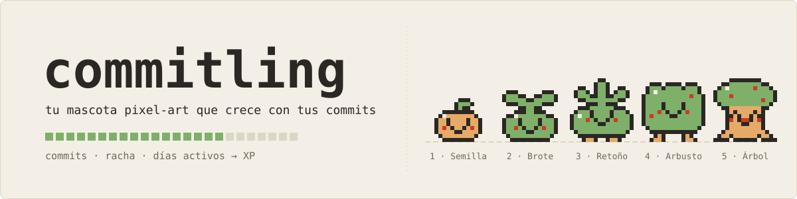

<div align="center">



**Una mascota pixel-art que vive en el README de tu perfil de GitHub y crece con tus commits.**

[](https://github.com/BertMarti/commitling/actions/workflows/ci.yml)
[](https://github.com/BertMarti/commitling/actions/workflows/deploy.yml)
[](LICENSE)
[](action.yml)
[](https://go.dev/)

### 🌱 [Pruébalo ahora en la web: bertmarti.github.io/commitling](https://bertmarti.github.io/commitling/)

</div>

<picture>
  <source media="(prefers-color-scheme: dark)" srcset="https://bertmarti.github.io/commitling/live/BertMarti-dark.svg">
  
</picture>

## ¿Qué es?

commitling es una GitHub Action que lee tu actividad pública, calcula tu experiencia y dibuja una criatura animada para el README de tu perfil. Empieza siendo una semilla y crece contigo.

- Crece con tus commits, pull requests, issues y demás actividad pública.
- Cambia de ánimo según tu actividad reciente y tu racha.
- Desbloquea gorro, bufanda y flor.
- Tiene tema claro u oscuro y tres especies: brote de musgo, hongo o cactus.

## 🎮 Pruébalo sin instalar nada

En la [web](https://bertmarti.github.io/commitling/#generador) escribes tu usuario de GitHub, eliges especie, tema y tamaño, pulsas **Dibujar** y ves tu criatura al momento. Desde ahí puedes **descargar el SVG** y copiar el **workflow ya relleno con tu usuario**.

¿Sin usuario a mano? Pulsa **«Ver demo: míralo crecer»**: en unos 15 segundos verás a una criatura de ejemplo pasar de semilla a árbol, con pausa, parada y un control para recorrer los días. No pide nada a GitHub.

> Sin iniciar sesión, GitHub deja hacer unas 60 consultas por hora. Si se agotan, la web te dice a qué hora vuelve a funcionar y te ofrece la demo mientras tanto. La Action de tu perfil no tiene ese límite.

## Úsalo en tu perfil en 4 pasos

> 🧭 **La forma más fácil:** abre el [generador del workflow](https://bertmarti.github.io/commitling/#instalar), escribe tu usuario, elige especie, tema y tamaño, y copia lo que sale. Tiene enlaces directos a cada paso en GitHub y te explica qué hacer si algo falla. Son unos 5 minutos y no hay que instalar nada ni crear tokens.

Si prefieres hacerlo a mano:

1. Abre (o crea) tu **repositorio de perfil**: un repositorio **público** que se llama exactamente igual que tu usuario, `tu-usuario/tu-usuario`. Si lo creas ahora, marca «Add a README file».
2. En ese repositorio pulsa **Add file → Create new file**, escribe como nombre `.github/workflows/commitling.yml` (cada barra crea una carpeta), pega este contenido y pulsa **Commit changes**:

```yaml
name: commitling

on:
  schedule:
    - cron: "23 5 * * *" # cada día a las 05:23 UTC
  workflow_dispatch:

permissions:
  contents: write

jobs:
  commitling:
    runs-on: ubuntu-latest
    steps:
      - uses: actions/checkout@v7
      - uses: BertMarti/commitling@v1
        with:
          out: commitling.svg
      - name: Guardar la criatura si ha cambiado
        run: |
          git add commitling.svg
          if git diff --cached --quiet; then
            echo "Sin cambios."
            exit 0
          fi
          git config user.name "github-actions[bot]"
          git config user.email "41898282+github-actions[bot]@users.noreply.github.com"
          git commit -m "chore: actualiza commitling"
          if ! git push; then
            echo "::error title=commitling::No se pudo guardar la criatura en el repositorio. Comprueba que este archivo tiene «permissions: contents: write» y, si la rama está protegida, deja que github-actions[bot] suba cambios."
            exit 1
          fi
```

3. Edita el `README.md` de tu repositorio de perfil (el lápiz) y pega donde quieras verla:

```markdown

```

4. Ve a la pestaña **Actions** (si te lo pregunta, pulsa «I understand my workflows, go ahead and enable them»), elige «commitling» y pulsa **Run workflow**. En uno o dos minutos aparece un ✓ verde y la criatura sale en tu perfil. A partir de ahí se actualiza sola cada día.

No hace falta tocar nada más: la línea `permissions: contents: write` deja que el workflow guarde la imagen en tu repositorio con un token temporal que GitHub crea en cada ejecución, y la Action usa como usuario al dueño del repositorio.

¿Tienes Go instalado y prefieres la terminal? `go run github.com/BertMarti/commitling/cmd/commitling@latest workflow --user tu-usuario --theme both` escribe el mismo archivo (con `--theme both`, claro y oscuro).

## Opciones

Puedes añadir estas entradas dentro de `with:`:

| Entrada | Por defecto | Qué hace |
|---|---|---|
| `user` | `${{ github.repository_owner }}` | Usuario cuya actividad pública se dibuja |
| `out` | `commitling.svg` | Archivo donde se guarda el SVG |
| `theme` | `light` | Usa `light` (papel) o `dark` (tinta) |
| `species` | `moss` | Elige `moss` (brote de musgo), `mushroom` (hongo) o `cactus` |
| `size` | `full` | Usa la tarjeta completa o la insignia `compact` de 200x60 |
| `token` | `${{ github.token }}` | Token de la API; normalmente basta el del workflow |
| `fixture` | vacío | Archivo de eventos para probar sin red |
| `keep-on-error` | `true` | Conserva la última criatura ante una caída pasajera de GitHub |

La salida `path` contiene la ruta absoluta del SVG generado. La Action crea el archivo; el último paso de tu workflow decide cuándo hacer commit.

## Especies

Las tres especies son originales y tienen las mismas reglas, fases, ánimos y accesorios.

| Fase | Desde | Brote de musgo (`moss`) | Hongo (`mushroom`) | Cactus (`cactus`) |
|---|---|---|---|---|
| 1 | 0 XP | Semilla | Espora | Yema |
| 2 | 100 XP | Brote | Botón | Bolita |
| 3 | 400 XP | Retoño | Seta | Cactus |
| 4 | 1.000 XP | Arbusto | Seta grande | Cactus con brazos |
| 5 | 2.500 XP | Árbol ancestral | Corro de setas | Cactus centenario |

<table>
  <tr>
    <td align="center"><br><sub><code>moss</code>: árbol ancestral, radiante</sub></td>
    <td align="center"><br><sub><code>mushroom</code>: corro de setas, radiante</sub></td>
    <td align="center"><br><sub><code>cactus</code>: cactus centenario, radiante</sub></td>
  </tr>
</table>

`species` también acepta `musgo`, `hongo` y `seta`, sin distinguir mayúsculas.

### Tarjeta compacta

Para una firma, una barra lateral o una cabecera, usa una insignia de 200x60:

```yaml
      - uses: BertMarti/commitling@v1
        with:
          out: commitling-compact.svg
          size: compact
```

Si la añades como un paso más, suma `commitling-compact.svg` al `git add` del último paso. Si solo quieres la compacta, basta con poner `size: compact` en el paso que ya tienes (o elegir «Compacta» en el generador).

<table>
  <tr>
    <td align="center"></td>
    <td align="center"></td>
    <td align="center"></td>
  </tr>
</table>

### Tema oscuro

Lo más sencillo es elegir **Automático (claro y oscuro)** en el [generador](https://bertmarti.github.io/commitling/#instalar) y sustituir tu workflow por el que sale. A mano: añade un segundo paso a tu workflow con `theme: dark` y `out: commitling-dark.svg`, súmalo al `git add` y deja que GitHub elija según el tema de quien visite tu perfil:

```yaml
      - uses: BertMarti/commitling@v1
        with:
          out: commitling-dark.svg
          theme: dark
```

Y en tu `README.md`:

```html
<picture>
  <source media="(prefers-color-scheme: dark)" srcset="./commitling-dark.svg">
  
</picture>
```

## Reglas

Solo cuentan los eventos públicos de los últimos 90 días y los días se calculan en UTC. La criatura es determinista: los mismos datos producen la misma tarjeta.

**Experiencia (XP)**

| Actividad | XP |
|---|---|
| Commit (cada commit de un push) | 10 |
| Pull request abierta | 25 |
| Issue abierta | 5 |
| Cualquier otro evento público (estrellas, forks, comentarios, revisiones…) | 2 |

**Fases**

| Fase | Desde |
|---|---|
| Semilla | 0 XP |
| Brote | 100 XP |
| Retoño | 400 XP |
| Arbusto | 1.000 XP |
| Árbol ancestral | 2.500 XP |

**Ánimos**

| Ánimo | Cuándo | Cómo se nota |
|---|---|---|
| Durmiendo | 7 días o más sin actividad (o ninguna) | Ojos cerrados, respiración lenta y «zzz» |
| Aburrido | De 3 a 6 días sin actividad | Párpados caídos y boca recta |
| Contento | Actividad en los últimos 3 días | Sonrisa, mejillas y parpadeo |
| Radiante | Racha de 5 días seguidos o más | Ojos felices, saltitos y destellos |

**Accesorios**

| Accesorio | Se desbloquea con |
|---|---|
| Gorro | Más de 30 días activos en los últimos 90 |
| Bufanda | Racha de 10 días o más |
| Flor | 5 repositorios distintos o más con commits, PR o issues |

Si GitHub falla un rato, tu criatura no desaparece: se conserva la última.

## Preguntas frecuentes

<details><summary>¿Es gratis?</summary>

Sí. El proyecto y la Action tienen licencia MIT. GitHub puede aplicar sus propios límites de uso de Actions y de la API pública.
</details>

<details><summary>¿Ve mis repositorios privados?</summary>

No. Solo lee la actividad pública que cualquiera puede ver en tu perfil.
</details>

<details><summary>El workflow sale en rojo, ¿qué hago?</summary>

Abre la ejecución en **Actions**: el mensaje de commitling aparece arriba, en el resumen, y dice qué hacer.

- «No se pudo guardar la criatura en el repositorio»: comprueba que el workflow tiene `permissions: contents: write`; si sigue fallando, en **Settings → Actions → General → Workflow permissions** elige **Read and write permissions**, y si tu rama principal está protegida permite que `github-actions[bot]` suba cambios.
- «no existe en GitHub (404)»: el `user:` está mal escrito (va sin `@`). Si quitas esa línea se usa el dueño del repositorio.
- «se ha agotado el límite de peticiones» o «GitHub no responde bien»: es pasajero; vuelve a lanzarlo más tarde. Cuando ya tienes una criatura, `keep-on-error` (activada por defecto) la conserva y el workflow ni siquiera falla: solo ves este error si aún no había ninguna o si la desactivaste.
- «GitHub no acepta el token (401)»: quita la entrada `token:` para usar el token automático del workflow, o renueva el secreto que le pasas.
</details>

<details><summary>¿Por qué no se actualiza?</summary>

El workflow se ejecuta una vez al día y solo guarda un archivo si la criatura ha cambiado. Puedes ir a **Actions → commitling → Run workflow**. GitHub desactiva los workflows programados tras unos 60 días sin actividad en el repositorio.
</details>

<details><summary>¿Puede bajar de fase o de XP?</summary>

Sí. Solo cuentan los últimos 90 días, así que la XP y los accesorios pueden cambiar cuando la actividad antigua deja de entrar en la ventana.
</details>

<details><summary>¿Cómo cambio a la seta o al tema oscuro?</summary>

Añade `species: mushroom` (o `species: cactus`) o `theme: dark` en `with:`. Para el tema oscuro, genera las dos imágenes y usa el bloque `<picture>` de esta página.
</details>

<details><summary>¿La criatura es de algún videojuego?</summary>

No. Es un diseño original, dibujado píxel a píxel para este proyecto.
</details>

<details><summary>¿Qué versión uso?</summary>

Usa `BertMarti/commitling@v1` para recibir mejoras compatibles. Si quieres fijar una versión concreta, usa una etiqueta exacta (por ejemplo `@v0.7.0`) o el SHA de un commit. Evita `@main`: es la rama de desarrollo.
</details>

## Privacidad

commitling solo usa la API pública de eventos de GitHub. No lee repositorios privados, no guarda datos fuera de tu repositorio y no necesita más permisos que el `GITHUB_TOKEN` de tu propio workflow.

---

¿Quieres colaborar o ver cómo funciona por dentro? Mira la [guía de desarrollo](docs/DESARROLLO.md), [CONTRIBUTING](CONTRIBUTING.md), la [guía de uso completa](docs/USO.md) y el [registro de cambios](CHANGELOG.md).

Licencia [MIT](LICENSE) · hecho por [BertMarti](https://github.com/BertMarti)
